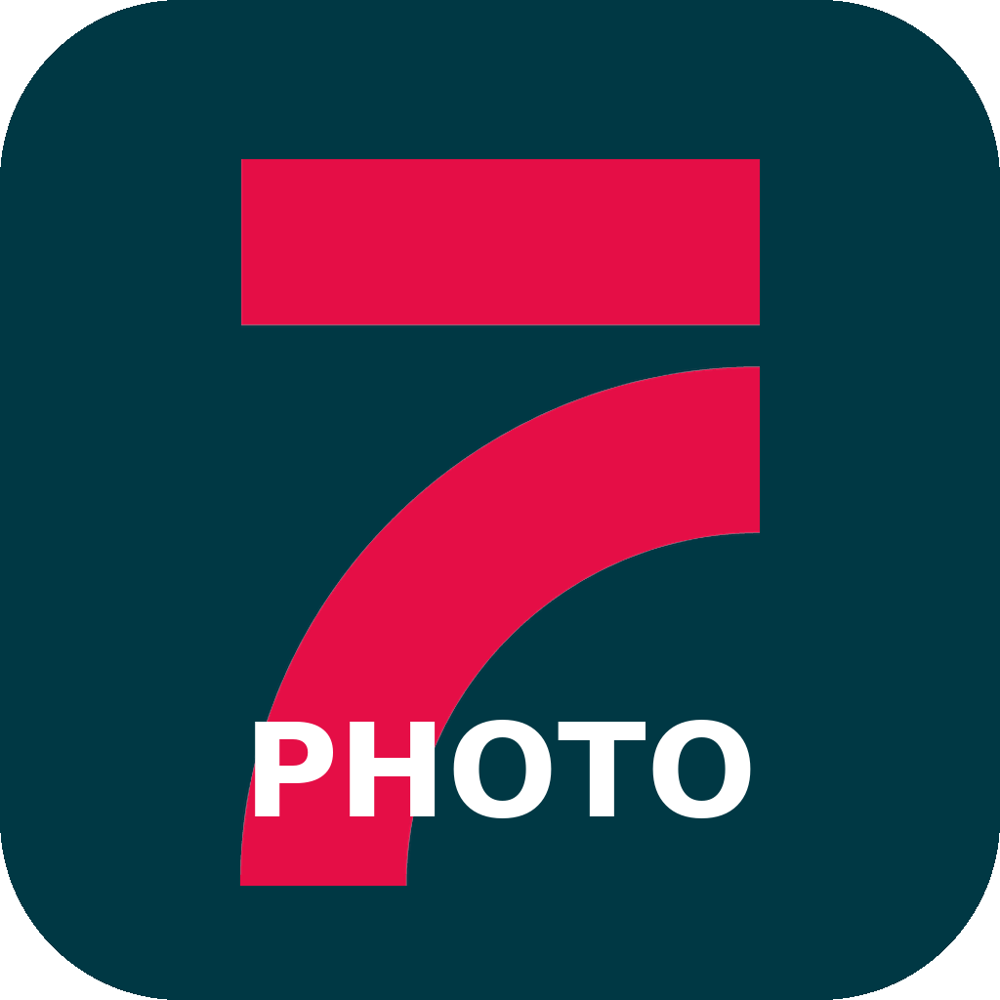

# STAR Photo

Editor de imagens da suíte STAR7, derivado do projeto open-source PhotoCraft. Esta distribuição modifica a identidade visual; os nomes internos, formatos de arquivo e identificadores de instalação são mantidos para compatibilidade.

## Documentação

A documentação técnica completa, instruções de compilação, funcionalidades e limitações da versão de origem foram preservadas no histórico: [documentação original desta versão](https://github.com/Devstar7/photocraft/blob/57eb86f3db524eef840c7fcd7372ff14808b3049/README.md).

- [Guia para contribuidores](CONTRIBUTING.md)
- [Documentação do projeto](docs/)
- [Planejamento](ROADMAP.md)
- [Suíte STAR7](https://suite.star-7.app.br)

## Compilação e distribuição

Os arquivos oficiais do aplicativo ficam em `assets/app-icon/`, `apps/photocraft/` e `packaging/`. O workflow **Actions → Release → Run workflow** gera os pacotes. Uma compilação concluída não equivale a uma release pública: teste o instalador Windows antes de anexá-lo em Releases.

## Licenças e origem

PhotoCraft é disponibilizado sob [MIT](LICENSE-MIT) ou [Apache-2.0](LICENSE-APACHE). Copyright (c) 2026 ArtCraft Team e contribuidores do PhotoCraft. Os avisos obrigatórios permanecem em [NOTICE](NOTICE); fontes, imagens e outros recursos mantêm suas próprias licenças em [ATTRIBUTION.md](ATTRIBUTION.md).

As imagens de marca ArtCraft foram removidas desta distribuição modificada. O aviso de marca original permanece em [docs/brand/LICENSE-brand.txt](docs/brand/LICENSE-brand.txt). A STAR7 não representa nem implica endosso da equipe original.

Adobe e Photoshop são marcas de seus respectivos titulares. Este projeto é independente e não é afiliado, patrocinado ou endossado pela Adobe.
